# Last Tower — Последняя башня

Мобильная игра-оборона, работающая прямо в браузере: в центре арены стоит башня — стартовая или купленная последняя, вокруг сходятся враги, а игрок расставляет и улучшает защитников, выбирает состав башни и управляет способностями ядра. Перед стартом выбирается один из четырёх режимов, а за победу начисляются монеты. В арсенале — три боевых защитника, два поддержки и эксклюзивный «Бог» для аккаунта основателя. Каждый день появляются три контракта, а за победы и полные ежедневные наборы открываются достижения. Прогресс синхронизируется через облачные аккаунты Supabase, а в «Штабе» есть общий рейтинг.

<p align="center">
  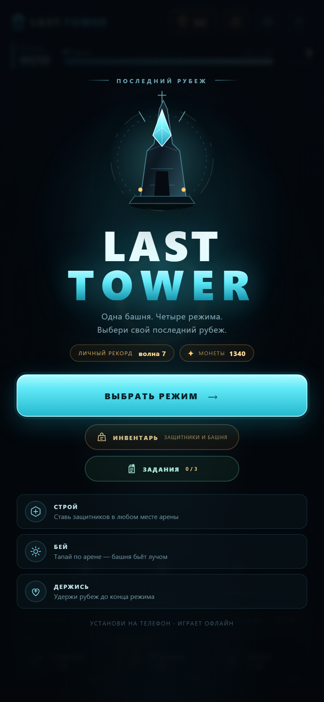
  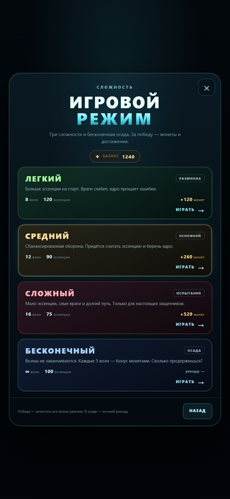
  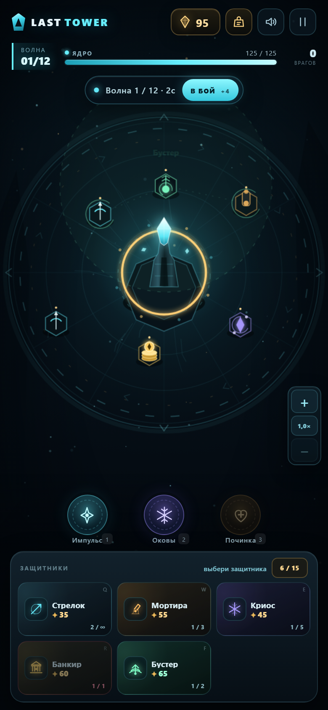
</p>
<p align="center">
  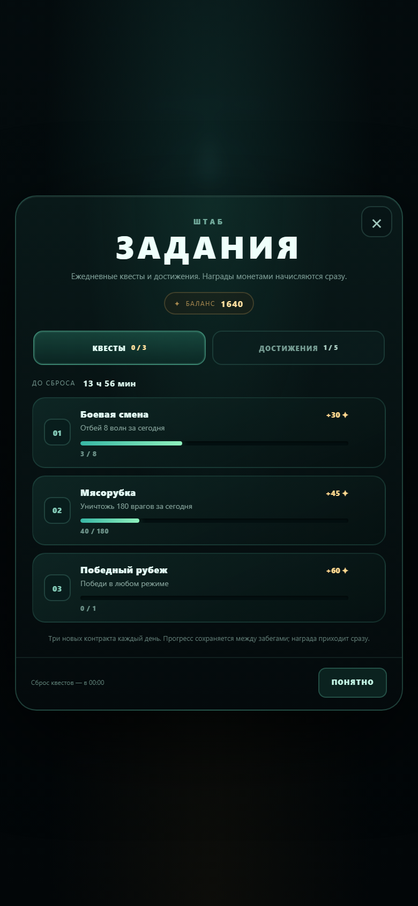
  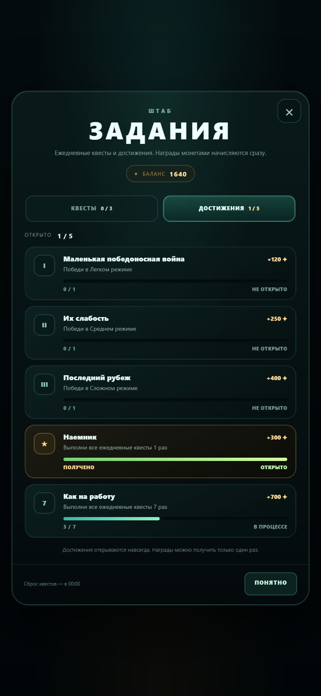
  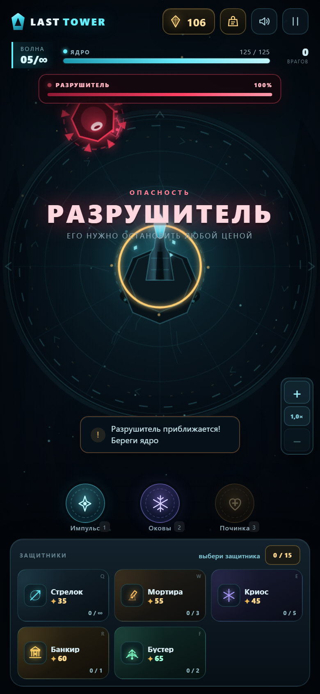
</p>
<p align="center">
  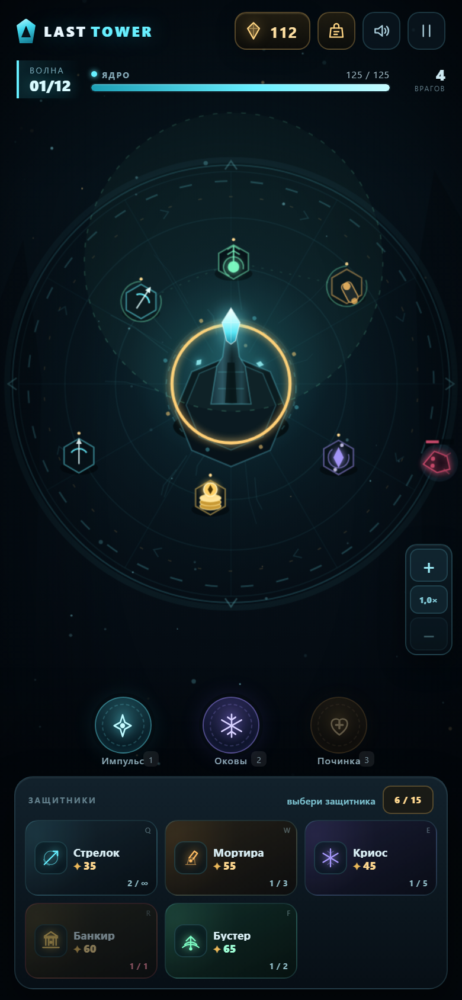
  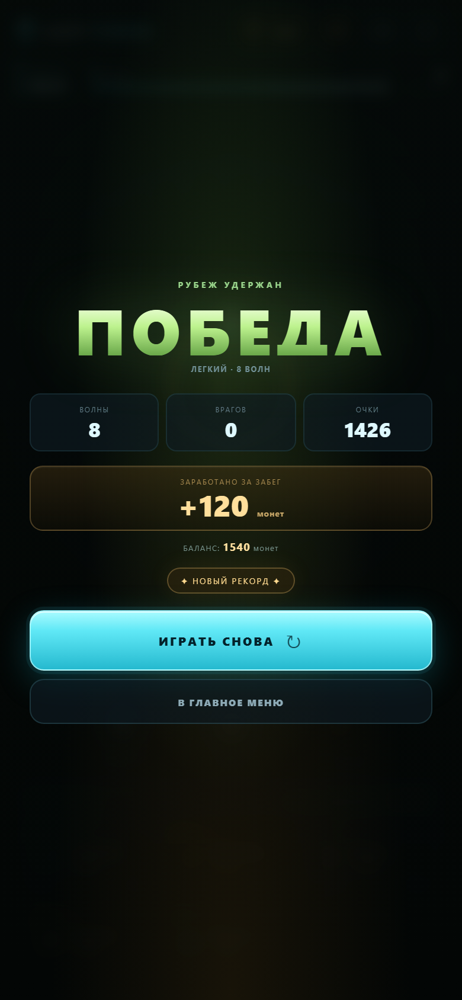
  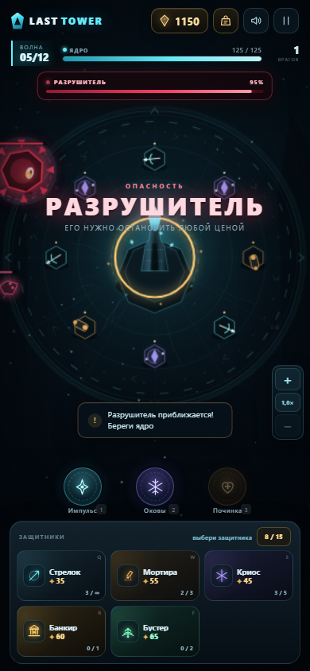
</p>
<p align="center">
  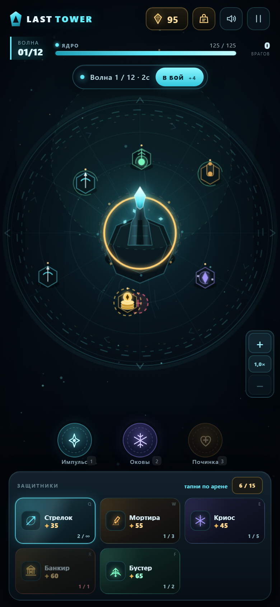
  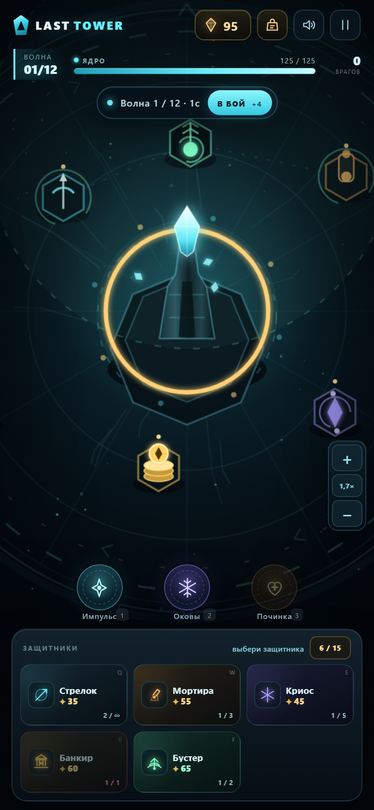
</p>
<p align="center">
  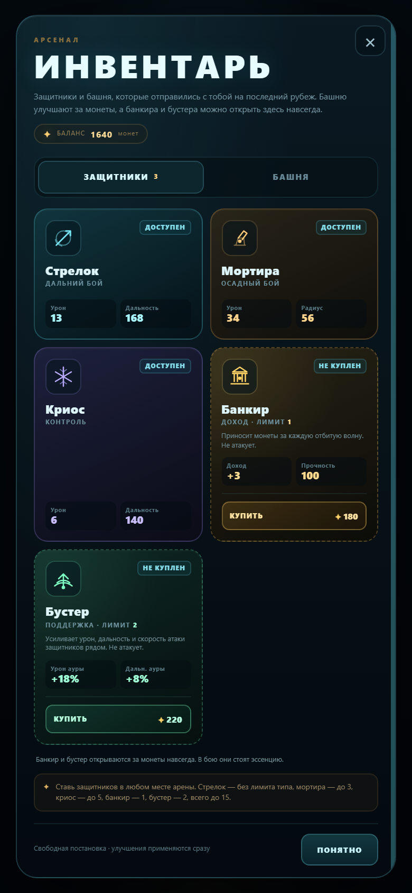
  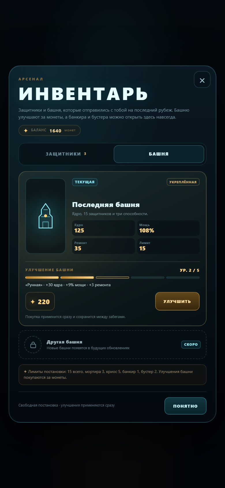
</p>

## Что внутри

- Четыре игровых режима — лёгкий, средний, сложный и бесконечный — с разным числом волн, стартовой эссенцией и силой врагов.
- В сложном режиме финальная волна — вражеская башня: она ворует монеты, копирует защитников, усиливает врагов, призывает боссов и бьёт по ядру молниями.
- Новые враги сложного режима: барабанщик усиливает союзников, некромант поднимает скелетов из черепов, а скелеты штурмуют арену вместе с остальными.
- Отдельная кнопка «ИНСТРУКЦИЯ» в главном меню вместо трёх подсказок: цель, постройка, ручной удар, способности и прогресс.
- Победа засчитывается после отражения последней волны выбранного режима; за неё один раз начисляется фиксированная награда монетами. В бесконечном режиме волны не заканчиваются, а каждые 5 отбитых волн дают бонус монетами.
- Три ежедневных квеста: волны, убийства и особая цель (победа, осада, боссы или постройки). Прогресс копится между забегами, награда начисляется сразу, а в 00:00 приходит новый набор.
- Пять достижений с наградами монетами: три за победы в обычных режимах, «Наемник» за один полностью закрытый день и «Как на работу» за семь таких дней.
- Облачные аккаунты Supabase: регистрация, вход, выход и синхронизация прогресса между устройствами; локальный режим остаётся запасным вариантом.
- Общий рейтинг в «Штабе»: лучшая волна и счёт в каждом из четырёх режимов, топ-50 игроков. Результаты основателя не попадают в публичную таблицу.
- Эксклюзивный защитник **«Бог»** для аккаунта основателя: очень быстрый тяжёлый удар по площади и аура усиления всех защитников.
- Монеты — отдельная мета-валюта: она сохраняется между забегами и тратится на постоянные улучшения двух башен и открытие банкира с бустером.
- Свободная постановка защитников в любом месте арены без сетки и фиксированных ячеек.
- Лимиты: всего до 15 защитников; состав зависит от башни — у стартовой 3 типа, у последней 5. Внутри каждого типа действуют прежние ограничения: стрелок — без лимита, мортира — до 3, криос — до 5, банкир — 1, бустер — 2, Бог — 1.
- Шесть типов защитников: три боевых, два поддержки и эксклюзивный «Бог». В стартовую башню можно взять 3 типа, в последнюю — 5; Бог у основателя доступен вне лимита состава. Банкир приносит монеты за каждую отбитую волну, бустер усиливает урон, дальность и скорость атаки защитников в радиусе ауры, Бог бьёт очень быстро и тяжело по площади, а его аура усиливает весь отряд.
- Улучшение защитников до 3 уровня и продажа с возвратом 60% вложений; у поддержек улучшаются доход и сила ауры.
- Приближение поля боя: пинч, колесо мыши и кнопки масштаба; панорамирование двумя пальцами.
- Инвентарь с отдельными вкладками защитников и двух башен. У стартовой и последней башни свои уровни и свой состав: нажми «Взять в состав» на карточке защитника. «Последняя» башня покупается за 500 монет.
- Три способности: у стартовой башни сначала только «Починка», «Импульс» открывается на максимальном уровне, «Оковы» недоступны; у последней доступны все три сразу. Плюс ручной тяжёлый выстрел по тапу.
- Экономика эссенции: доход во время боя, награда за волну, бонус за досрочный старт и траты на защитников.
- Пауза, звук, рекорд волны и очков, баланс монет, облачная синхронизация и локальный запасной режим.
- PWA: устанавливается на телефон и работает офлайн после первого запуска.
- Адаптивное качество рендера: на слабом устройстве разрешение канваса снижается автоматически, чтобы сохранить плавность.
- Никаких сборщиков и внешних библиотек — только HTML, CSS и Canvas 2D.

## Две башни

В инвентаре теперь две башни, и у каждой свои уровни, цена улучшений и состав защитников.

- **Стартовая башня** доступна сразу. Её базовая форма близка к прежнему «Бастиону»: 245 ядра, 140% мощи и 46 ремонта. В состав входят 3 типа защитников. Из способностей доступна «Починка»; «Импульс» открывается только на 5-м уровне, «Оковы» недоступны.
- **Последняя башня** покупается за 500 монет. В состав входят 5 типов защитников, а «Импульс», «Оковы» и «Починка» доступны сразу, без ожидания максимального уровня.
- Состав выбирается в инвентаре кнопками «Взять в состав» / «Убрать из состава». Для стартовой башни максимум 3 типа, для последней — 5.
- **Бог** у аккаунта основателя доступен всегда и не занимает место в составе.
- Переключение башни меняет её уровень, лимиты и доступные способности в текущем забеге; составы хранятся отдельно.

## Аккаунты, облако и сохранение

В главном меню есть кнопка **«АККАУНТ»**. По умолчанию аккаунты облачные: вход и регистрация идут через Supabase Auth, а прогресс хранится в таблице `profiles`. Логин превращается в служебный адрес вида `<login>@players.lasttower.local`, поэтому в проекте Supabase должен быть выключен **Confirm email**. Пароль не хранится в игре и не попадает в `localStorage` в открытом виде — его хеширует Supabase Auth.

- **Регистрация** — логин из 3–20 символов (латиница, цифры, `_`), отображаемое имя до 24 символов и пароль от 8 символов. При регистрации можно сразу перенести текущий гостевой прогресс.
- **Вход** — логин и пароль. После входа игра перезагружается с облачным сохранением; на новом устройстве достаточно войти тем же аккаунтом.
- **Синхронизация** — изменения сохраняются в облако с небольшой задержкой, а также при уходе со страницы. У сохранения есть версия: если два устройства изменили прогресс одновременно, клиент подтягивает более свежую серверную версию и перезагружается, а не затирает её молча.
- **Выход** — очищает локальную сессию и возвращает экран входа.
- **Удаление** — у облачного аккаунта кнопка скрыта: публичный ключ Supabase не может удалить пользователя из `auth.users`. Локальный аккаунт в запасном режиме по-прежнему можно удалить.
- **Гость** — можно закрыть окно и играть без аккаунта; гостевой прогресс лежит в старых ключах `lastTower.*`.
- **Локальный режим** — открой игру с параметром `?local=1`, если нужен старый вход без сети и без Supabase. В этом режиме работают локальные аккаунты и `localStorage`, но синхронизации и рейтинга нет.

У каждого аккаунта отдельные монеты, уровни и составы двух башен, открытые защитники, рекорды, ежедневные квесты, достижения, бестиарий и настройки звука. Облачный сейв — это JSON-карта всех игровых ключей `STORAGE`; локальная копия имеет вид `lastTower.account.<id>.*`, поэтому аккаунты не перетирают друг друга. Схема базы и RPC лежат в `supabase/schema.sql`.

При первом запуске в Supabase уже создан **аккаунт основателя** с логином `dmitry`; его профиль имеет серверный флаг `is_owner=true`. Только этот аккаунт видит и может ставить защитника **«Бог»**. Пароль основателя не хранится в клиентском коде как источник истины: доступ даёт серверный профиль, а не локальная копия. Если профиль основателя потерян, флаг восстанавливается SQL-запросом из `supabase/owner.sql`.

### Рейтинг

В «Штабе» есть вкладка **«РЕЙТИНГ»** с четырьмя режимами. Для каждого аккаунта хранится лучшая волна и лучший счёт; таблица показывает топ-50 по волне, затем по очкам. Результат отправляется после победы или поражения. Забеги аккаунта основателя исключены из публичной таблицы, чтобы «Бог» не ломал общий рейтинг.

Важное ограничение: очки присылает клиент, поэтому рейтинг не является защищённым от читерства соревнованием. RLS и RPC не дают подменить чужой профиль или имя, но не проверяют, честно ли сыгран забег. Для строгого античита нужен серверный обсчёт или replay-проверка.

### Ограничения и безопасность

Публичный ключ `sb_publishable_...` можно хранить в клиенте — он предназначен для браузера. Ключ `service_role` в игру не попадает и не должен попадать. Доступ к чужим профилям закрыт RLS; сохранение и отправка очков идут через security-definer RPC. Восстановления пароля пока нет, потому что у аккаунта нет настоящей почты — пароль нужно записать. Очистка данных браузера удаляет локальную копию и сессию, но облачный прогресс остаётся на сервере. Облачный вход из `file://` работает в Chrome/Chromium, но отдельные мобильные браузеры могут блокировать сеть или хранилище; для стабильной работы и PWA лучше HTTPS.

### Настройка Supabase

1. Создай проект на [supabase.com](https://supabase.com).
2. В **Authentication → Sign In / Providers → Email** включи Email-провайдер и выключи **Confirm email**. Логины игроков используют служебный домен `players.lasttower.local`, поэтому письма не отправляются.
3. Открой **SQL Editor → New query**, вставь `supabase/schema.sql` и нажми **Run**. Запрос идемпотентный: таблицы `profiles` и `leaderboard`, RLS-политики и RPC можно создавать повторно.
4. Создай пользователя основателя в **Authentication → Users** (или через `/auth/v1/signup`) с email `dmitry@players.lasttower.local`. Затем выполни `supabase/owner.sql`, чтобы выставить `is_owner=true`. В этой сборке профиль основателя уже создан.
5. Публичные URL и publishable-ключ проекта заданы константами `CLOUD_URL` и `CLOUD_PUBLIC_KEY` в начале `js/game.js`. Для другого проекта замени их и пересобери телефонную сборку.
6. Никогда не вставляй в клиент `service_role`/secret key. Для DDL и обслуживания используй SQL Editor или сервер.

Проверка: `/auth/v1/settings` должен возвращать `email:true` и `mailer_autoconfirm:true`; вход `dmitry` должен давать `is_owner=true` в профиле и карточку «Бог» в инвентаре.

## Режимы и награды

Кнопка «ВЫБРАТЬ РЕЖИМ» открывает экран выбора. В каждом режиме своя длина забега, стартовый запас эссенции, множители силы врагов и награда монетами.

| Режим | Волн | Стартовая эссенция | Награда |
|---|---:|---:|---|
| Лёгкий | 8 | 100 | 120 монет за победу |
| Средний | 12 | 78 | 260 монет за победу |
| Сложный | 16 | 60 | 520 монет за победу |
| Бесконечный | ∞ | 90 | +10 монет за каждые 5 волн |

- Сложность растёт быстрее: HP врагов прибавляет `24%` за волну, урон — `8,5%`, скорость упирается в `+42%`. Количество врагов доходит до 48, а интервал спавна сокращается до `0,18 с`. Поэтому поздние волны требуют не только больше защитников, но и улучшений, способностей и правильной расстановки.
- Победа наступает после отражения последней волны режима. Награда начисляется один раз и сразу сохраняется в `localStorage`. Если на арене стоит банкир, его доход за волны добавляется к монетам сразу, а в итоговой сумме на экране победы показывается награда режима вместе с заработком банкира.
- В бесконечном режиме победы нет: забег идёт до падения башни, а отдельный рекорд по волнам показывается в карточке режима. Бонус за каждые 5 волн начисляется сразу и сохраняется даже при поражении.
- Поражение награду за режим не даёт; монеты, заработанные банкиром и осадными бонусами, и остальной баланс не сгорают.
- Баланс виден в главном меню, на экране выбора режима, в инвентаре, на экране победы и в «Штабе».
- «ЕЩЁ РАЗ» на экране результата и «ИГРАТЬ СНОВА» на экране победы запускают тот же режим. Сменить режим можно через главное меню.
- Монеты тратятся на улучшение выбранной башни во вкладке «Башни», на покупку последней башни, на постоянное открытие банкира и бустера во вкладке «Защитники», а также приходят за ежедневные квесты и достижения.

## Финальный босс сложного режима

На 16-й волне сложного режима появляется **вражеская башня** — зеркало последней башни игрока. Она стоит в верхней части арены и не идёт к ядру, но постоянно давит на защиту:

- **Кража монет.** Каждые несколько секунд башня забирает часть мета-валюты из кошелька. Украденное не возвращается после победы, поэтому финальную волну лучше не затягивать.
- **Копии защитников.** Накопив украденные монеты, башня создаёт враждебную копию одного из боевых защитников игрока. Копия атакует отряд и ядро, но не считается врагом бестиария.
- **Молния.** Башня начинает каст и через 6 секунд бьёт по ядру. Чтобы сорвать удар, нужно нанести ей достаточно урона за это окно; на экране есть отдельная строка с обратным отсчётом.
- **Импульс.** Когда у башни остаётся две трети HP, она снимает по трети здоровья с каждого защитника и с ядра.
- **Заморозка.** На одной трети HP защитники и башня игрока замирают на 5 секунд.
- **Последние силы.** На 15% HP башня восстанавливает половину запаса, призывает Короля и Разрушителя и даёт игроку 12 секунд. Если не добить её за это время, она восстановит ещё 35% максимума.
- **Усиление врагов.** Периодически башня делает всех противников на арене быстрее и сильнее.

Параллельно на сложном режиме появляются **барабанщик** (усиливает союзников в радиусе), **некромант** (поднимает скелетов из черепов, оставшихся после предыдущей волны) и **скелеты** — более живучие и быстрые, чем ползуны.

## Ежедневные квесты

Кнопка «ШТАБ» в главном меню открывает экран «Штаб» с вкладками «Квесты», «Достижения» и «Враги».

- Каждый день выдаются три контракта: один на отбитые волны, один на уничтоженных врагов и один особый — победа в любом режиме, выход на 8-ю волну осады, уничтожение двух боссов или постройка 12 защитников.
- Прогресс суммируется между забегами и сохраняется в `localStorage`; квесты можно закрывать в любом режиме. Награда монетами начисляется сразу, отдельно забирать её не нужно.
- После выполнения всех трёх квестов день считается закрытым. Это открывает достижение «Наемник», а семь закрытых дней — «Как на работу».
- Новый набор появляется в 00:00 по локальному времени. В шапке экрана показан обратный отсчёт до сброса, а на кнопке в меню — счётчик выполненных квестов.
- Кнопка «ПОНЯТНО», крестик, тап по фону или `Esc` закрывают «Штаб».

## Достижения

| Достижение | Условие | Награда |
|---|---|---:|
| Маленькая победоносная война | Победить в лёгком режиме | 120 монет |
| Их слабость | Победить в среднем режиме | 250 монет |
| Последний рубеж | Победить в сложном режиме | 400 монет |
| Наемник | Выполнить все ежедневные квесты 1 раз | 300 монет |
| Как на работу | Выполнить все ежедневные квесты 7 раз | 700 монет |

Достижения открываются навсегда и сохраняются между перезапусками. Награда начисляется один раз; повторные победы и повторное закрытие дня монет за достижение не дают. Семь дней не обязаны идти подряд — учитываются любые полностью закрытые дни.

## Бестиарий

В «Штабе» есть вкладка **«Враги»** — постоянный справочник на **13 карточек**, который открывается за убийства **конкретного типа врага**: ползуны открывают ползуна, Короли — Короля, барабанщики — барабанщика и так далее. До открытия враг показывается как «???» с числом убийств этого типа и прогресс-баром; после открытия видны базовые HP, среднее фактическое HP, урон, скорость, эссенция, режимы появления, описание и особая черта. Вражеская башня открывается после 10 убийств, некромант — после 60, скелет — после 120, барабанщик — после 180. Подробности и пороги — в **[ENEMIES.md](ENEMIES.md)**.

## Управление

| Действие | Телефон | Клавиатура |
|---|---|---|
| Выбрать защитника | тап по карточке внизу | `1`–`6` — по порядку карточек |
| Поставить защитника | тап по пустому месту арены | — |
| Открыть инвентарь | кнопка инвентаря в HUD или «ИНВЕНТАРЬ» в меню | — |
| Открыть квесты, достижения и бестиарий | «ШТАБ» в главном меню | — |
| Открыть инструкцию | «ИНСТРУКЦИЯ» в главном меню | — |
| Войти или создать аккаунт | «АККАУНТ» в главном меню | — |
| Купить банкира / бустера | инвентарь → «Защитники» → «КУПИТЬ» за монеты | — |
| Выбрать состав башни | инвентарь → «Защитники» → «Взять в состав» / «Убрать из состава» | — |
| Выбрать активную башню | инвентарь → «Башни» → «Стартовая» / «Последняя» | — |
| Улучшить башню | инвентарь → «Башни» → «УЛУЧШИТЬ» | — |
| Купить последнюю башню | инвентарь → «Башни» → «КУПИТЬ ЗА 500» | — |
| Выбрать режим / начать забег | «ВЫБРАТЬ РЕЖИМ» → «Лёгкий» / «Средний» / «Сложный» / «Бесконечный» | — |
| Открыть улучшение | тап по защитнику | — |
| Ручной выстрел башни | тап по врагу на арене | — |
| Приблизить / отдалить | щипок двумя пальцами или кнопки «+» / «−» | колесо мыши, `+` / `−` |
| Сбросить масштаб | кнопка с текущим масштабом | `0` |
| Сдвинуть поле | перетаскивание двумя пальцами | правая или средняя кнопка мыши |
| Способности | кнопки «Импульс», «Оковы», «Починка» | `Q` / `W` / `E` |
| Досрочно начать волну | кнопка «В БОЙ» | `Space` |
| Пауза | кнопка «II» | `Esc` |

## Инструкция

Кнопка **«ИНСТРУКЦИЯ»** в главном меню открывает отдельный экран с четырьмя короткими блоками: защита ядра, постройка защитников, тапы и способности, прогресс и аккаунт. Это замена трём старым подсказкам «Строй / Бей / Держись».

Экран закрывается кнопкой «ПОНЯТНО», крестиком, тапом по фону или `Esc`. После закрытия фокус возвращается на кнопку «ИНСТРУКЦИЯ».

## Масштаб поля

Поле боя можно приблизить до 3×, чтобы точнее выбирать цели и свободные места для защитников.

- На телефоне — щипок двумя пальцами; масштаб меняется вокруг точки между пальцами.
- Панорамирование — перетаскивание двумя пальцами.
- На компьютере — колесо мыши (вокруг курсора), правая или средняя кнопка мыши для сдвига.
- Кнопки `+` / `−` справа над панелью управления и кнопка с текущим масштабом для сброса.
- Клавиши `+`, `−`, `0`; `Esc` закрывает инвентарь, инструкцию, «Штаб» или выбор режима, затем снимает выделение/инспектор, а после этого ставит игру на паузу.
- Интерфейс и панель управления остаются на месте — двигается и масштабируется только арена.

## Свободная постановка

Сетки и фиксированных ячеек больше нет: защитника можно поставить в любой свободной точке арены. Карточка внизу выбирает тип, а следующий тап по арене ставит бойца. На компьютере под курсором показывается призрак с радиусом постановки.

| Тип | Лимит типа | Общий лимит |
|---|---:|---:|
| Стрелок | без лимита | 15 |
| Мортира | 3 | 15 |
| Криос | 5 | 15 |
| Банкир | 1 | 15 |
| Бустер | 2 | 15 |
| Бог | 1 | 15 |

- Счётчик в шапке магазина показывает `0 / 15`, а на карточках — `0 / ∞`, `0 / 3`, `0 / 5`, `0 / 1`, `0 / 2` и `0 / 1`.
- Лимиты задаются уровнем башни в `TOWER_LEVELS[].limits`; текущие уровни используют 15/∞/3/5/1/2/1, но другая башня или улучшение может переопределить любое из значений.
- Какая башня активна и какие типы входят в её состав, задают `TOWER_SPECS`, `towerLoadouts` и ключ сохранения `lastTower.towers.v1`.
- Карточки банкира, бустера и Бога появляются в магазине только после открытия и добавления в состав; Бог у основателя доступен вне состава. До этого они скрыты.
- Нельзя ставить защитника слишком близко к башне, слишком близко к другому защитнику, на врага или за границу арены. Игра объяснит причину и не спишет эссенцию.
- Эссенция списывается только после успешной постановки. Повторный тап по карточке или `Esc` отменяют выбранный тип без трат.
- Продажа или гибель защитника освобождает его место и возвращает лимит типа и общий лимит.
- Позиции защитников пересчитываются при повороте экрана и изменении размера окна, поэтому отряд остаётся внутри арены.

## Инвентарь

В HUD появилась кнопка инвентаря, а в главном меню — кнопка «ИНВЕНТАРЬ». Открывается экран «Арсенал» с двумя вкладками:

- **Защитники** — карточки Стрелка, Мортиры, Криоса, а также банкира и бустера. Банкир и бустер сначала показаны как покупки за монеты; после оплаты они навсегда открываются. Кнопка «Взять в состав» / «Убрать из состава» добавляет тип в активную башню: у стартовой максимум 3 типа, у последней — 5. У аккаунта основателя здесь же видна эксклюзивная карточка **«Бог»**; она доступна вне состава.
- **Башни** — выбор между «Стартовой» и «Последней», их отдельные уровни, характеристики и покупка последней башни за 500 монет.

В шапке инвентаря отображается баланс монет. Улучшение выбранной башни, покупка последней башни и открытие защитников списываются сразу и сохраняются в `localStorage`; если монет не хватает, покупка не происходит и появляется подсказка. Кнопка «ПОНЯТНО», крестик, тап по фону или `Esc` закрывают инвентарь. Если открыть его во время подготовки или боя, игра ставится на паузу и после закрытия возвращается в тот же режим; волна и таймеры не двигаются.

## Улучшения башни

У каждой башни свои четыре платных улучшения и свой сохранённый уровень. Стартовая и последняя используют одинаковую таблицу характеристик, но покупаются отдельно.

| Уровень | Название | Ядро | Мощь | Ремонт | Лимит | Цена |
|---:|---|---:|---:|---:|---:|---:|
| 1 | Базовая | 245 | 140% | 46 | 15 | — |
| 2 | Укреплённая | 275 | 148% | 49 | 15 | 120 монет |
| 3 | Рунная | 310 | 157% | 52 | 15 | 220 монет |
| 4 | Цитадель | 350 | 167% | 56 | 15 | 360 монет |
| 5 | Бастион | 395 | 178% | 60 | 15 | 520 монет |

- Лимит типа задаётся отдельно: мортира 3, криос 5, банкир 1, бустер 2, Бог 1, стрелок без персонального ограничения. Общий лимит — 15; его можно менять в данных уровня башни.
- Количество доступных **типов** задаёт башня: стартовая — 3, последняя — 5; это не общий лимит защитников.
- Улучшение применяется сразу: максимум ядра растёт, а текущее ядро получает прибавку к запасу. Следующий забег начинается с новыми характеристиками.
- «Мощь» увеличивает урон автоматического выстрела башни, ручного удара, «Импульса» и «Оков».
- «Ремонт» — сколько HP восстанавливает способность «Починка» за одно использование.
- Уровень и потраченные монеты сохраняются между перезапусками страницы отдельно для каждой башни. Максимальный уровень — 5; после него кнопка показывает «МАКС».

## Защитники

| Защитник | Цена в бою | Открытие | Лимит | Роль |
|---|---:|---:|---:|---|
| Стрелок | 35 | — | ∞ | Быстрые одиночные выстрелы, хорошая дальность |
| Мортира | 55 | — | 3 | Тяжёлый снаряд с уроном по площади |
| Криос | 45 | — | 5 | Замедляет и замораживает врагов рядом |
| Банкир | 60 | 180 монет | 1 | Даёт монеты за каждую отбитую волну, не атакует |
| Бустер | 65 | 220 монет | 2 | Усиливает защитников в радиусе ауры, не атакует |
| Бог | 120 | аккаунт основателя | 1 | Очень быстрый тяжёлый удар по площади и аура усиления |

Стартовый запас зависит от режима: 100 эссенции в лёгком, 78 в среднем, 60 в сложном и 90 в бесконечном. В лёгком этого хватает на две постройки, в сложном придётся экономить каждый кристалл. Каждый защитник улучшается до 3 уровня; продажа возвращает 60% вложенного. Общий лимит — 15 защитников на арене.

### Банкир и бустер

- **Банкир** приносит `+3` монеты после каждой отбитой волны. На 2 уровне доход растёт до `+4`, на 3 — до `+5`. Монеты начисляются сразу в мета-баланс и сохраняются, даже если забег закончится поражением. На финальной волне доход тоже начисляется и входит в итоговую сумму на экране победы.
- **Бустер** даёт ауру радиусом 126 (136 на 2 уровне, 146 на 3). Внутри ауры боевые защитники получают `+18% / +24% / +30%` к урону, `+8% / +11% / +14%` к дальности и `+10% / +14% / +18%` к скорости атаки. Две ауры складываются; на банкира и других поддержек аура не действует.
- Оба поддержки не атакуют, но их можно улучшать и продавать. После продажи или гибели бустера бонусы ауры сразу снимаются с оставшихся защитников.
- Открытие покупок постоянно: банкир и бустер оплачиваются монетами один раз и затем доступны в каждом забеге. Цена в бою списывается эссенцией, как у остальных защитников.

### Бог — эксклюзив основателя

**«Бог»** не покупается за монеты и не появляется у обычных аккаунтов. Он доступен только аккаунту основателя (`dmitry`) и только на устройствах, где этот аккаунт активен.

| Параметр | Значение |
|---|---:|
| Цена в бою | 120 эссенции |
| HP | 240 (341 на 2 уровне, 442 на 3) |
| Урон | 36 (54,7 на 2 уровне, 73,4 на 3) |
| Интервал атаки | 0,24 с (0,224 / 0,209 с) |
| Дальность | 185 (196 / 207) |
| Урон по площади | 40 (44 / 48) |
| Аура | радиус 170; +22% урона, +10% дальности, +12% скорости |
| Лимит | 1 |

- Атака — мгновенный тяжёлый луч по цели и половина урона врагам в радиусе взрыва. Это самый высокий DPS среди защитников.
- Аура Бога складывается с аурой бустера и действует на всех боевых защитников, кроме самого Бога и поддержек. После продажи или гибели Бога бонус снимается.
- Бог не открывается в инвентаре у других аккаунтов и не может быть поставлен через отладочный API без активного аккаунта основателя. В магазине защитников его карточка скрыта, пока нет доступа.
- На клавиатуре Бог выбирается цифрой своей карточки — обычно последней.

## Способности башни

| Способность | Клавиша | Перезарядка | Эффект |
|---|---|---:|---|
| Импульс | `Q` | 14 с | Урон и отбрасывание по всей арене. У стартовой башни — только на 5-м уровне; у последней — сразу |
| Оковы | `W` | 19 с | Заморозка на 2,4 с и сильное замедление. Только у последней башни |
| Починка | `E` | 28 с | Восстанавливает 46–60 HP ядра в зависимости от уровня башни |

## Враги

В игре **тринадцать типов врагов**. Полные характеристики, формулы масштабирования, состав волн и тактические заметки — в **[ENEMIES.md](ENEMIES.md)**.

| Враг | HP | Урон | Скорость | Особенность |
|---|---:|---:|---:|---|
| Ползун | 30 | 4 | 31 | базовый ближний бой, с 1-й волны |
| Бегун | 20 | 3 | 55 | самый быстрый, хрупкий, со 2-й волны |
| Плевун | 40 | 4 | 24 | дальний бой, с 4-й волны |
| Громила | 106 | 9 | 20 | идёт только к ядру и бьёт защитников на пути, с 6-й волны |
| Лекарь | 52 | 3 | 26 | лечит до трёх раненых врагов рядом, с 4-й волны (кроме лёгкого) |
| Камикадзе | 24 | 44 | 66 | бежит к ближайшему защитнику и взрывается, с 5-й волны (кроме лёгкого) |
| Барабанщик | 78 | 4 | 22 | усиливает союзников в радиусе, сложный режим с 7-й волны |
| Некромант | 105 | 5 | 24 | поднимает скелетов из черепов, сложный режим, 10-я и 14-я волны |
| Скелет | 46 | 4 | 42 | призыв некроманта, живучее ползуна |
| Разрушитель | 330 | 16 | 15 | босс лёгкого режима и каждой 5-й волны бесконечного |
| Король | 340 | 15 | 13 | босс среднего и сложного, призывает охранников каждые 8 секунд |
| Охранник | 84 | 8 | 23 | миньон Короля, приоритет — защитники |
| Вражеская башня | 820 | — | 0 | финальный босс сложного режима; молнии, кража монет, копии и последние силы |

- Все враги получают замедление и заморозку; брони и иммунитетов нет.
- Обычный босс добавляется сверх волны и появляется последним; вражеская башня на 16-й волне появляется первой.
- В лёгком режиме Разрушитель выходит только на 5-й волне; в бесконечном — каждые 5 волн.
- В среднем режиме Король появляется на 5-й и 10-й волнах, в сложном — на 5-й, 10-й и 15-й, а на 16-й выходит вражеская башня.
- Громила не останавливается перед защитниками: он идёт к башне и наносит контактный урон всем, кто оказался на пути.
- Если убить камикадзе до взрыва, урон не наносится. Взрыв не даёт эссенцию и не считается убийством.
- Убийства дают эссенцию, а не монеты. Монеты начисляются за волны, банкира, квесты и достижения.
- Бестиарий во вкладке «Враги» открывается за убийства конкретного типа врага, а не за общий счётчик.

## Запуск

Игра не требует сборки. Достаточно открыть `index.html`; в Chrome облачный вход работает и из `file://`, но для service worker, установки на телефон и офлайна нужен HTTP/HTTPS-сервер. Если мобильный браузер блокирует сеть из файла, открой игру через сервер или добавь `?local=1`.

Самый простой способ на Windows — дважды щёлкнуть **`start-game.bat`**: он проверит, не запущен ли сервер, при необходимости поднимет `python -m http.server` на всех локальных интерфейсах и откроет игру в браузере. В окне консоли он также печатает адрес для телефона. Окно **Last Tower Server** нельзя закрывать во время игры.

С телефона в той же Wi-Fi-сети открой напечатанный адрес вида `http://192.168.0.4:8765/`. Один раз запусти **`allow-phone-access.bat`** и подтверди запрос администратора — он добавит в брандмауэр входящее правило только для TCP-порта 8765. После этого новую версию игры **не нужно пересылать на телефон**: обнови файлы на компьютере и перезагрузи страницу на телефоне.

Если телефон вообще не видит компьютер (роутер изолирует устройства), остаётся автономная сборка **`LastTower-phone.html`**: один HTML-файл со встроенными CSS и JS. Её нужно перекидывать вручную, поэтому для постоянной игры лучше сервер или HTTPS-хостинг. В Chrome/Chromium облачный вход и синхронизация работают и из `file://`; для PWA и максимальной совместимости с мобильными браузерами открой эту же сборку по HTTPS, а для полностью офлайн-игры добавь `?local=1`. Сборка пересобирается командой:

```powershell
python tools/build-phone.py
```

Подробный сценарий показа учителю с таймингом, техническими тезисами и планом Б лежит в **[DEMO.md](DEMO.md)**.

```powershell
cd "C:\Users\Dmitry Kuzmichev\Desktop\Last Tower"
python -m http.server 8765 --bind 127.0.0.1
```

Открыть: <http://127.0.0.1:8765/>

Для проверки с телефона в той же Wi-Fi-сети:

```powershell
python -m http.server 8765 --bind 0.0.0.0
```

Затем открыть `http://<IP-компьютера>:8765/` на телефоне. Если Windows Firewall спросит разрешение для Python — разрешить в локальной сети.

> Важно: service worker и полноценная установка PWA работают только в secure context — по `https://` или на `localhost`. При открытии по локальному IP через HTTP игра запустится, но офлайн-кэш может не включиться. Для установки на телефон выложите папку на GitHub Pages, Netlify, Cloudflare Pages или любой HTTPS-хостинг.

### Обновление игры на телефоне без пересылки файла

1. **Дома, по Wi-Fi (бесплатно).** Запусти `start-game.bat`, открой на телефоне `http://<IP-компьютера>:8765/` и добавь страницу на главный экран. Когда меняешь игру на компьютере, просто обнови страницу на телефоне. Главное — не закрывать окно **Last Tower Server** и держать компьютер включённым.
2. **Из любой точки (HTTPS).** Выложи папку игры на GitHub Pages, Netlify, Cloudflare Pages или другой статический хостинг. Телефон открывает постоянную ссылку, а обновления появляются после загрузки новой версии на хостинг. Это же включает PWA и офлайн-кэш. Для GitHub Pages в проекте есть `publish-github.bat`, `publish-github.ps1`, `.nojekyll` и пошаговая инструкция **[GITHUB-PAGES.md](GITHUB-PAGES.md)**.
3. **Автономный `LastTower-phone.html`** оставь для случаев, когда нет Wi-Fi или нужно показать игру без компьютера. Он не обновляется сам: новый файл всё равно придётся перекинуть.

Облачная синхронизация сохраняет **прогресс**, но не обновляет **код игры**. Чтобы не пересылать новый HTML, нужен именно сервер или хостинг.

### Установка на телефон

- **Android / Chrome:** меню браузера → «Установить приложение» или «Добавить на главный экран».
- **iPhone / Safari:** «Поделиться» → «На экран «Домой»».

После установки игра открывается без адресной строки в портретной ориентации.

## Структура

```text
Last Tower/
├── index.html              # разметка интерфейса
├── css/style.css           # тёмная неоновая тема, адаптив, оверлеи
├── js/game.js              # игровой цикл, волны, бой, рендер, звук
├── manifest.webmanifest    # PWA-манифест
├── sw.js                   # service worker и офлайн-кэш
├── start-game.bat          # сервер, игра на ПК и адрес для телефона
├── allow-phone-access.bat  # разрешить входящий порт 8765 в брандмауэре
├── publish-github.bat      # публикация обновления на GitHub Pages
├── publish-github.ps1      # сценарий git init/commit/push для Pages
├── GITHUB-PAGES.md         # пошаговая настройка GitHub Pages
├── .nojekyll               # отключить Jekyll на GitHub Pages
├── .gitignore              # не коммитить тестовые и временные файлы
├── LastTower-phone.html    # автономная однофайловая сборка для телефона
├── DEMO.md                 # сценарий показа проекта учителю
├── ENEMIES.md              # характеристики врагов и разбор волн
├── assets/                 # иконки приложения
├── supabase/               # schema.sql и owner.sql для облака
├── screenshots/            # скриншоты для документации
└── tools/                  # генератор иконок и CDP-проверки
```

## Проверки

Синтаксис:

```powershell
node --check js/game.js
node --check sw.js
```

В браузере доступен отладочный интерфейс `window.LastTower`: активный аккаунт, состояние, режим, целевая волна, баланс и заработанные монеты, уровень и характеристики башни, HP, эссенция, защитники, счётчики и лимиты постановки, открытые типы, доход банкира, враги, очередь спавна, бестиарий и открытые враги, перезарядки, камера, состояние инвентаря, выбора режима и «Штаба», ежедневные квесты, достижения, рекорд бесконечного режима, облачная сессия и профиль (`cloud`, `cloudSave`), а также команды `startGame('easy' | 'medium' | 'hard' | 'endless')`, `startNextWave`, `finishWave`, `spawnBoss(type = 'boss')`, `spawnEnemy(type, x, y)`, `damageEnemy(index, amount)`, `clearEnemies`, `setEnemyKills(type, kills)`, `useAbility`, `strike`, `placeDefender(type, x, y)`, `cancelPlacement`, `buyTowerUpgrade`, `buyDefender('banker' | 'booster')`, `refreshAuras`, `openInspector(type, index)`, `closeInspector`, `upgradeSelected`, `sellSelected`, `openModeSelect`, `closeModeSelect`, `openProgress`, `closeProgress`, `advanceDaily(metric, value)`, `victory`, `openInventory`, `closeInventory`, `zoomAt`, `resetCamera`, `damageTower`, `setMoney`, `setWave`, `addEssence`, `cloudFlush()`.

Для принудительного высокого качества рендера (например, для скриншотов) откройте игру с параметром `?hq=1`.

CDP-скрипты в `tools/` использовались для проверки вёрстки на 320/390/768/1440 px, касаний, пинч-зума, свободной постановки и лимитов 3/5/1/2/1/15, покупки банкира и бустера за монеты, ауры усиления, дохода за волны, четырёх режимов, бесконечной осады и отдельного рекорда, победы и начисления монет, ежедневных квестов и сброса дня, пяти достижений, паузы, инвентаря, двух башен с отдельными уровнями, составов 3/5, горячих клавиш 1–6 и Q/W/E, улучшений защитников и башни, продажи и оверлея поражения, регистрации, входа, выхода и удаления локального аккаунта, а также эксклюзивного Бога и его ауры. В облачной версии отдельно проверены вход и регистрация Supabase, перенос прогресса на «другое устройство», конфликт версий сохранения, обновление истёкшей сессии, отправка результата, фильтрация основателя в рейтинге, облачный вход из `file://` на телефонной сборке и повторные перезагрузки без цикла сохранений. Скриншоты можно пересобрать командой `node tools/make-shots.mjs`. Для запуска нужен локальный Chrome/Edge с открытым remote debugging port `9224` и статический сервер на `127.0.0.1:8765`.
